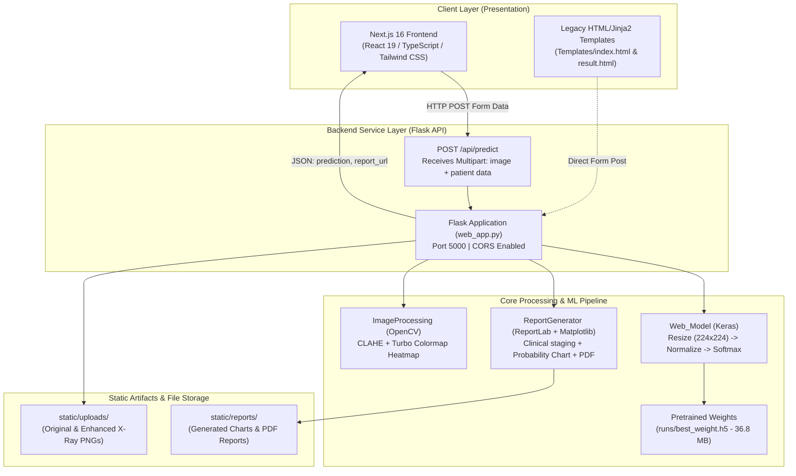

# Comprehensive Technical Analysis: Lung Disease Classification Project

---

## 1. Executive Summary

The **Lung Disease Classification** project is an end-to-end medical AI diagnostic system that analyzes Chest X-ray (CXR) radiography images to classify four pulmonary conditions:
1. **COVID-19**
2. **Normal (Healthy)**
3. **Pneumonia**
4. **Tuberculosis (TB)**

The system integrates:
- A custom **Deep Convolutional Neural Network (CNN)** built with TensorFlow/Keras.
- An **Image Preprocessing & Enhancement Engine** using OpenCV (Contrast Limited Adaptive Histogram Equalization - CLAHE and Turbo colormap fusion).
- An **Automated Clinical Report Generator** utilizing ReportLab and Matplotlib to compile patient metadata, diagnosis, disease staging, and precautionary guidance into a PDF.
- A **RESTful Flask Backend** serving inference and report retrieval endpoints.
- A **Modern Next.js 16 + React 19 + TypeScript Frontend** offering a clinical intake form, interactive image upload, real-time predictions, and PDF report downloads.
- A legacy **Flask Jinja2 template interface** preserved from earlier project iterations.

---

## 2. Architecture & System Topography

### 2.1 Architecture Diagram



---

## 3. Directory & File Inventory

```
Lung_disease/
│
├── Classes/                                # Python core domain modules
│   ├── ImageProcessing.py                 # CLAHE enhancement & pseudo-heatmap generation
│   ├── Model.py                           # CNN architecture definition, dataset loader & training logic
│   ├── ReportGenerator.py                 # Automated PDF generation, plotting & clinical staging
│   └── Web_Model.py                       # Lightweight inference engine for runtime predictions
│
├── lung-classifier-web/                   # Modern Web Application (Next.js 16 App Router)
│   ├── app/
│   │   ├── class/page.tsx                 # Diagnostic workflow & patient metadata submission page
│   │   ├── globals.css                    # Tailwind CSS v4 directives & dark theme styling
│   │   ├── layout.tsx                     # Root layout with Geist font injection
│   │   └── page.tsx                       # Landing portfolio / introduction page
│   ├── package.json                       # Next.js 16.0.8, React 19.2.1, Tailwind CSS 4
│   ├── tsconfig.json                      # TypeScript configuration
│   └── next.config.ts                     # Next.js runtime configuration
│
├── resources/
│   └── logo.png                           # Clinical logo graphic embedded in PDF headers
│
├── runs/
│   └── best_weight.h5                     # Saved Keras HDF5 model weights (36.8 MB)
│
├── Templates/                             # Legacy Jinja2 Flask web views
│   ├── index.html                         # Basic image upload form
│   └── result.html                        # Basic prediction output view
│
├── .gitignore                             # Git ignore rules for Python, Node.js & generated files
├── LICENSE                                # MIT Open Source License (2024 Mustafa Mert Çolak)
├── README.md                              # Project documentation & operational guidelines
├── train.py                               # Model training entrypoint script
└── web_app.py                             # Flask application entrypoint & API controller
```

---

## 4. In-Depth Component Analysis

### 4.1 Deep Learning Pipeline (`Model.py`, `Web_Model.py`, `train.py`)

#### Model Architecture
The network is a custom Sequential Convolutional Neural Network (CNN) specifically tailored for 4-class multi-class image classification:

| Layer Type | Configuration | Output Shape | Parameters / Purpose |
| :--- | :--- | :--- | :--- |
| **Input Rescaling** | `Rescaling(1./255)` | `(224, 224, 3)` | Pixel intensity normalization to `[0.0, 1.0]` |
| **Conv Block 1** | `Conv2D(32, 3x3, relu)` + `MaxPooling2D(2, 2)` | `(111, 111, 32)` | Low-level edge and texture extraction |
| **Conv Block 2** | `Conv2D(64, 3x3, relu)` + `MaxPooling2D(2, 2)` | `(54, 54, 64)` | Corner and basic shape detection |
| **Conv Block 3** | `Conv2D(128, 3x3, relu)` + `MaxPooling2D(2, 2)` | `(26, 26, 128)` | Intermediate anatomical feature representations |
| **Conv Block 4** | `Conv2D(256, 3x3, relu)` + `MaxPooling2D(2, 2)` | `(12, 12, 256)` | High-level pulmonary pattern representations |
| **Conv Block 5** | `Conv2D(512, 3x3, relu)` + `MaxPooling2D(2, 2)` | `(5, 5, 512)` | Complex pathological lesion detection |
| **Classifier Head** | `Flatten()` | `(12800,)` | Vector flattening |
| **Dense Layer** | `Dense(128, activation='relu')` | `(128,)` | Fully connected feature integration |
| **Output Layer** | `Dense(4, activation='softmax')` | `(4,)` | Class probability distribution |

#### Training Configuration:
- **Optimization**: Adam optimizer.
- **Loss Function**: `sparse_categorical_crossentropy`.
- **Validation Regularization**: `EarlyStopping(monitor='val_loss', patience=3, restore_best_weights=True)`.
- **Target Classes**: `['COVID-19', 'NORMAL', 'PNEUMONIA', 'TUBERCULOSIS']`.
- **Dataset Partition**:
  - Training: 4,244 images
  - Validation: 1,818 images
  - Testing: 1,070 images
  - Total: 7,132 labeled chest radiographs.

---

### 4.2 Image Processing Engine (`Classes/ImageProcessing.py`)

The enhancement pipeline optimizes visual contrast for clinical readability:
1. **Grayscale Conversion**: Image read in single-channel format (`cv2.IMREAD_GRAYSCALE`).
2. **CLAHE (Contrast Limited Adaptive Histogram Equalization)**:
   - `clipLimit=2.0`, `tileGridSize=(8, 8)`.
   - Prevents over-amplification of noise while revealing subtle parenchymal lung infiltrates and consolidations.
3. **Pseudo-Color Heatmap**:
   - `cv2.applyColorMap(enhanced_img, cv2.COLORMAP_TURBO)`.
4. **Weighted Alpha Blending**:
   - `cv2.addWeighted(enhanced_3ch, 0.7, heatmap, 0.3, 0)`.
   - 70% structural grayscale detail preserved with 30% thermal gradient overlay.

> [!NOTE]
> In `web_app.py`, the author added a crucial safeguard: model inference is run on the **original unaltered image**, while the **CLAHE enhanced image** is utilized exclusively for the doctor's visual PDF report. This prevents distribution shift from misleading the CNN.

---

### 4.3 Automated Clinical Reporting Engine (`Classes/ReportGenerator.py`)

The report generator produces publication-grade medical diagnosis summaries:
- **Condition Staging**:
  - `NORMAL`: Marked "Healthy" (Green).
  - `< 70%` Confidence: "Early Stage (Stage 1)" (Orange).
  - `70% - 85%` Confidence: "Moderate (Stage 2)" (Orange).
  - `85% - 95%` Confidence: "Severe (Stage 3)" (Red).
  - `> 95%` Confidence: "Critical (Stage 4)" (Red).
- **Probability Distribution Visualization**:
  - Matplotlib non-interactive backend (`matplotlib.use('Agg')`).
  - Bar chart with annotated values rendered directly to disk.
- **Dynamic Precautions**:
  - Embedded prescription and care advice tailored specifically to each detected pathology.
- **PDF Layout**:
  - ReportLab `canvas.Canvas` on standard `letter` dimensions.
  - Institutional logo header, patient demographics table, dual-image layout (Enhanced Scan + Probability Graph), clinical staging, precautions, and AI diagnostic disclaimer footer.

---

### 4.4 Backend API Layer (`web_app.py`)

- **Framework**: Flask with `flask_cors.CORS(app)`.
- **Endpoints**:
  - `POST /api/predict`:
    - Accepts multipart `FormData`: `image` (binary file), `id`, `name`, `age`, `history`.
    - Saves original image to `static/uploads/`.
    - Generates enhanced image via `ImageProcessing`.
    - Executes prediction via `Web_Model`.
    - Generates probability chart and PDF report via `ReportGenerator`.
    - Returns JSON: `{"prediction": "<CLASS>", "report_url": "<URL>"}`.
  - `GET /`: Status route indicating Flask backend health and referencing the Next.js port.

---

### 4.5 Frontend User Experience (`lung-classifier-web/`)

- **Tech Stack**: Next.js 16 (App Router), React 19, TypeScript, Tailwind CSS v4.
- **User Interface Features**:
  - **Landing Page (`app/page.tsx`)**: Minimalist dark-mode landing page with animated gradients and navigation to classifier.
  - **Clinical Interface (`app/class/page.tsx`)**:
    - Patient intake form (Patient ID, Full Name, Age, Medical History).
    - Drag-and-drop / click-to-upload chest X-ray file dropzone with instant client-side preview (`URL.createObjectURL`).
    - Asynchronous form submission with animated loading state (`"Analyzing..."`).
    - Glowing diagnosis badge (`Normal`, `COVID-19`, `Pneumonia`, or `Tuberculosis`).
    - One-click PDF report download button.

---

## 5. Critical Code Flaws, Bugs, & Technical Debt

During our line-by-line inspection, several key bugs and architectural deficiencies were detected:

### ⚠️ Issue 1: Mocked Probabilities in Backend (`web_app.py`)
- **Location**: `web_app.py`, lines 58–74:
  ```python
  prediction = model.predict(image.copy())
  # Mock probabilities for the report
  confidence = 0.95
  probabilities = {'COVID-19': 0.05, 'NORMAL': 0.05, 'PNEUMONIA': 0.05, 'TUBERCULOSIS': 0.05}
  probabilities[prediction] = confidence
  ```
- **Consequence**: `Web_Model.predict` internally calculates the actual softmax output (`self.model.predict(...)`), but discards the array and returns only `predicted_class`. In `web_app.py`, probabilities and confidence are **hardcoded to 95%** for every single image! This means the bar graph and disease severity staging in the generated PDF do not reflect real model probabilities.
- **Fix**: Update `Web_Model.predict` to return both `(predicted_class, confidence, probabilities_dict)`.

### ⚠️ Issue 2: Hardcoded Training & Data Paths (`Model.py` & `train.py`)
- **Location**: `Classes/Model.py` line 13:
  ```python
  os.mkdir("LungDiseaseClassification/runs")
  ```
  and `train.py` line 5:
  ```python
  model = LungModel("LungDiseaseClassification/Data")
  ```
- **Consequence**: The repository name is `Lung_disease`, not `LungDiseaseClassification`. Running `python train.py` from the project root will fail with `FileNotFoundError` unless exact directory structures are matched.

### ⚠️ Issue 3: Hardcoded API Endpoint in Next.js Client
- **Location**: `lung-classifier-web/app/class/page.tsx` line 42:
  ```typescript
  const res = await fetch('http://localhost:5000/api/predict', ...)
  ```
- **Consequence**: Breaks immediately when deployed to staging, Docker, Vercel, or any remote IP. Should use `process.env.NEXT_PUBLIC_API_URL || 'http://localhost:5000'`.

### ⚠️ Issue 4: Absence of Data Augmentation & Dropout
- **Location**: `Classes/Model.py` lines 44–62.
- **Consequence**: The model uses 5 sequential convolution blocks without Dropout layers or data augmentation (rotation, zoom, horizontal flips). Dense layer `Dense(128)` directly follows a 12,800-dimension Flatten without dropout, creating a high risk of memorization/overfitting on medical imaging artifacts.

### ⚠️ Issue 5: Storage Accumulation & Privacy Leak
- **Location**: `web_app.py` lines 12–15 (`static/uploads/`, `static/reports/`).
- **Consequence**: All uploaded images and generated medical reports containing patient names, ages, and medical histories are saved persistently with public URLs and no authentication, session gating, or automated file retention/deletion cleanup.

---

## 6. Recommendations & Action Plan

| Priority | Category | Recommendation |
| :---: | :--- | :--- |
| **P0** | **Bug Fix** | Refactor `Web_Model.predict()` to return true softmax probability distribution and wire real confidence values to `ReportGenerator`. |
| **P1** | **Configuration** | Abstract backend host in Next.js into `.env.local` (`NEXT_PUBLIC_API_URL`). Fix training paths in `Model.py` and `train.py`. |
| **P2** | **ML Quality** | Implement Transfer Learning with pretrained medical backbones (e.g., `DenseNet121` or `EfficientNetB0`), add data augmentation (`RandomFlip`, `RandomRotation`), and introduce `Dropout(0.3)`. |
| **P3** | **Explainability** | Replace artificial CLAHE color maps with true **Grad-CAM (Gradient-weighted Class Activation Mapping)** to highlight exact anatomical lesion locations influencing model decisions. |
| **P4** | **Deployment & Security** | Add Dockerization (`Dockerfile` for Flask + Next.js), container networking, and automated file pruning (TTL cleanup for static files). |

---

## 7. Technology Stack Summary Table

| Layer | Technologies / Libraries |
| :--- | :--- |
| **Deep Learning** | TensorFlow 2.x, Keras, NumPy |
| **Computer Vision** | OpenCV (`cv2`), Pillow (PIL) |
| **Data & Visualization** | Matplotlib (`Agg` backend) |
| **Document Generation**| ReportLab (PDF Canvas & Drawing API) |
| **Backend API** | Python 3, Flask, Flask-CORS |
| **Frontend Framework** | Next.js 16.0.8 (App Router), React 19.2.1 |
| **Styling & Language** | Tailwind CSS v4, TypeScript 5, Geist Sans/Mono fonts |
| **Version Control** | Git, GitHub (`Rohitprakasam/Lung_disease`) |

