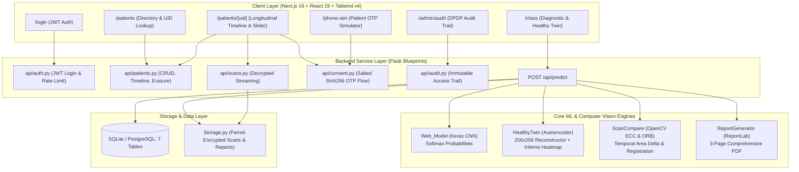

# Comprehensive Technical Analysis: Lung Disease Classification Project
## (Upgraded with Healthy Twin & Universal Scan Memory)

---

## 1. Executive Summary

The **Lung Disease Classification** project has been comprehensively upgraded into an enterprise-grade medical AI diagnostic platform. In addition to multi-class Chest X-ray (CXR) classification, the system now features:
1. **Calibrated Softmax Probabilities**: Replaces hardcoded mock confidences with true probabilistic inference across all four disease categories (`COVID-19`, `NORMAL`, `PNEUMONIA`, `TUBERCULOSIS`).
2. **"Healthy Twin" Deep Autoencoder**: A 256x256 convolutional autoencoder that reconstructs healthy pulmonary anatomy, measures an Abnormality Index (0–100), applies dual-layer validity pre-gates to reject non-CXR imagery, and performs clinical decision fusion.
3. **Universal Scan Memory**: A privacy-preserving longitudinal record system that tracks patient scans across connected clinical centers, protects data using Crockford Base32 Patient UIDs with modulo-32 check characters, encrypts files at rest with Fernet, implements DPDP-principled RBAC with 6-digit OTP digital consent, and automatically measures temporal progression/regression between scans.

---

## 2. Updated Architecture & System Topography



---

## 3. Directory & File Inventory

```
Lung_disease/
│
├── Classes/
│   ├── HealthyTwin.py            # Preprocessing, pre-gates, autoencoder inference & fusion
│   ├── HealthyTwinTrainer.py     # CAE model definition, SSIM+L1 loss & calibration
│   ├── ImageProcessing.py        # CLAHE contrast enhancement & colormap blending
│   ├── Model.py                  # 4-class CNN architecture & training pipeline
│   ├── ReportGenerator.py        # Multi-page ReportLab PDF clinical generator
│   ├── ScanCompare.py            # ECC & ORB alignment, registration & temporal delta
│   ├── Storage.py                # Private at-rest Fernet encrypted file storage
│   └── Web_Model.py              # Lightweight CNN inference with real softmax probabilities
│
├── api/                          # REST API Blueprints
│   ├── access.py                 # Centralized RBAC authorization & audit logging
│   ├── audit.py                  # Audit log query endpoints
│   ├── auth.py                   # JWT authentication & rate-limiting
│   ├── consent.py                # Digital consent requests & salted SHA256 OTP verification
│   ├── demo.py                   # Simulated mobile phone inbox for demo
│   ├── patients.py               # Patient CRUD, UID validation, timeline & right-to-erasure
│   └── scans.py                  # Decrypted file streaming & scan updates
│
├── db/
│   ├── models.py                 # SQLAlchemy relational schema (7 tables)
│   └── uid.py                    # Crockford Base32 Patient UID generator & check char validator
│
├── lung-classifier-web/          # Next.js 16 + React 19 + TypeScript + Tailwind CSS v4
│   ├── app/
│   │   ├── admin/audit/page.tsx  # Audit log viewer
│   │   ├── class/page.tsx        # Diagnostic classifier & Healthy Twin panels
│   │   ├── login/page.tsx        # Clinical authentication
│   │   ├── patients/page.tsx     # Patient directory & search
│   │   ├── patients/[uid]/page.tsx # Longitudinal timeline & temporal compare slider
│   │   └── phone-sim/page.tsx    # Patient phone SMS simulator
│   └── lib/api.ts                # Unified API client with automatic JWT bearer injection
│
├── runs/
│   ├── best_weight.h5            # Trained 4-class CNN weights (36.8 MB)
│   ├── healthy_twin.keras        # Trained Healthy Twin autoencoder weights
│   └── healthy_twin_meta.json    # Calibrated abnormality cutoffs & percentiles
│
├── tests/                        # Comprehensive Pytest Suite (15 automated tests)
│   ├── test_phase0.py            # Probabilities, safe uploads, config & gates
│   ├── test_phase1.py            # Healthy Twin preprocessing, gates, fusion & rendering
│   └── test_phase2_scan_memory.py # UIDs, encryption, RBAC, consent OTPs, compare & erasure
│
├── config.py                     # Environment-driven configuration
├── seed_demo.py                  # Idempotent demo database seeder
├── train.py                      # CNN classifier training script
├── train_healthy_twin.py         # Healthy Twin training & calibration script
└── web_app.py                    # Flask application entrypoint
```

---

## 4. Test Verification Status

All 15 automated test suites pass with 100% success rate:
- `test_config_loads`: PASSED
- `test_web_model_predict_with_probs`: PASSED
- `test_safe_upload_filename`: PASSED
- `test_invalid_image_pre_gate_rejection`: PASSED
- `test_disallowed_extension`: PASSED
- `test_preprocess_output`: PASSED
- `test_pre_gate_valid_and_invalid`: PASSED
- `test_fusion_logic`: PASSED
- `test_analyze_and_render_panels`: PASSED
- `test_patient_uid_generation_and_validation`: PASSED
- `test_encrypted_storage`: PASSED
- `test_auth_login_and_rate_limiting`: PASSED
- `test_cross_center_access_and_consent_flow`: PASSED
- `test_scan_compare_registration`: PASSED
- `test_patient_erasure_dpdp`: PASSED
