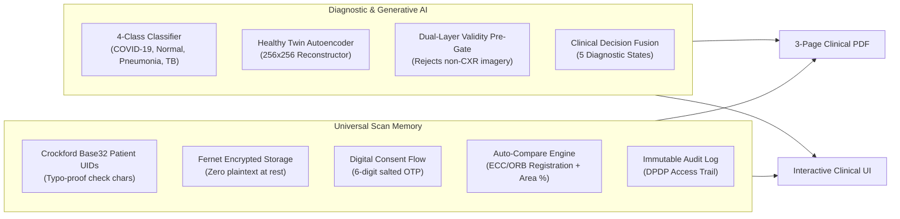

# Lung Disease Classification, Healthy Twin & Universal Scan Memory
## User Manual & Feature Documentation Guide

---

## 1. System Overview

This platform is an enterprise-grade medical AI diagnostic system for **Chest Radiographs (CXR)**. It combines:
1. **Multi-Class Convolutional Neural Network (CNN)** for disease detection.
2. **"Healthy Twin" Deep Autoencoder** for anatomical reconstruction, anomaly heatmaps, and validity gating.
3. **Universal Scan Memory** for longitudinal multi-center patient tracking, encrypted storage, digital OTP consent, and automated comparative progression analysis.

---

## 2. Core Features Breakdown



### 2.1 4-Class CNN Diagnostic Classifier
- **Pathologies Identified**:
  - `COVID-19`: Ground-glass opacities and bilateral consolidations.
  - `NORMAL`: Healthy pulmonary parenchyma and clear cardiothoracic boundaries.
  - `PNEUMONIA`: Bacterial and viral consolidations, lobar infiltrates.
  - `TUBERCULOSIS`: Apical cavitations and fibrocaseous infiltrates.
- **Calibrated Probabilities**: Outputs real softmax probabilities across all four classes rather than binary decisions or mocked confidences.

### 2.2 "Healthy Twin" Deep Autoencoder
- **Anatomical Baseline Model**: Built with a narrow 16×16×16 bottleneck (4,096 latent parameters) and **no skip connections**, trained exclusively on healthy (`NORMAL`) chest radiographs using a joint `0.84 * (1 - SSIM) + 0.16 * L1` loss function.
- **Abnormality Index (0–100)**: Quantifies disease burden as a percentile score against the distribution of healthy anatomy. Values above the 95th percentile indicate severe pulmonary abnormalities.
- **Inferno Difference Heatmap**: Highlights exact anatomical regions deviating from the reconstructed healthy baseline.
- **Dual-Layer Validity Pre-Gate**:
  - *Heuristic Pre-Gate*: Checks image dimensions (&ge; 180px), aspect ratio (0.55–1.65), color saturation divergence (detects selfies/photos), and intensity contrast (blocks blank/corrupted images).
  - *Reconstruction Gate*: Rejects non-CXR imagery if autoencoder reconstruction error exceeds physical thresholds. Returns **HTTP 422** with a clear explanation.
- **Clinical Decision Fusion**:

| Classifier Decision | Healthy Twin Evaluation | Clinical Status | Clinical Advice / Action |
| :--- | :--- | :--- | :--- |
| **NORMAL** | Normal (&le; cutoff) | `consistent_normal` | Normal lung anatomy verified by both models. |
| **Disease X** | Abnormal (> cutoff) | `consistent_disease` | Pathology confirmed; lesion area highlighted on heatmap. |
| **NORMAL** | Abnormal (> cutoff) | `unknown_abnormal` | Unclassified lesion detected; refer patient to specialist. |
| **Disease X** | Normal (&le; cutoff) | `low_agreement` | Discrepancy detected; clinical radiological review advised. |
| **Any** | Invalid Input | `invalid_image` | Non-CXR radiograph rejected (HTTP 422). |

### 2.3 Universal Scan Memory
- **Crockford Base32 Patient UIDs (`PT-XXXX-XXXX`)**: 12-character identifiers using an alphabet that eliminates visual confusions (`I`, `L`, `O`, `U`) and incorporates a modulo-32 check character to catch typos before submission.
- **Encrypted-at-Rest Storage**: Scans and PDF reports are encrypted using authenticated `Fernet` (AES-128-CBC + HMAC-SHA256). Files cannot be read from the filesystem without the server's private key.
- **Digital Consent Architecture (DPDP Act 2023 Principles)**:
  - Doctors can only see scans originating from their own registered center by default.
  - Scans from other hospitals display as hidden counts.
  - Cross-center access requires generating a 6-digit OTP sent to the patient's phone.
  - Verifying the OTP grants **30 days** of cross-center viewing.
  - Patients can unilaterally revoke access at any time via the patient portal / phone simulator.
- **Immutable Clinical Audit Trail**: Every login, scan inspection, report download, consent request, and denied access attempt is written to an append-only audit log.
- **DPDP Right to Erasure**: Admin endpoint (`DELETE /api/patients/<uid>`) permanently purges encrypted scan directories and anonymizes patient demographics while preserving audit trail integrity.

### 2.4 Automated Scan-to-Scan Progression Engine
- **Image Registration**: Uses OpenCV Enhanced Correlation Coefficient (ECC) with fallback to ORB + RANSAC to geometrically align previous and current scans.
- **Area Delta Calculation**: Quantifies the percentage increase or reduction in abnormal lung area:
  $$\text{Area Delta \%} = \frac{\text{Area}_{\text{new}} - \text{Area}_{\text{prev}}}{\max(\text{Area}_{\text{prev}}, 0.01)} \times 100$$
- **Chromatic Progression Map**: Overlays a visual change map where:
  - **Green**: Regions where infiltrates have resolved/cleared.
  - **Red**: Regions where disease or opacity has worsened.
- **Interactive Split Slider**: Scrub horizontally between scans in the web interface to visually assess temporal evolution.

### 2.5 Multi-Page Clinical PDF Reports
1. **Page 1 (Diagnostic Report)**: Patient demographics, 4-class classification, model certainty score, enhanced radiograph, probability distribution bar chart, and pathology precautions.
2. **Page 2 (AI Visual Analysis)**: Triptych visual panel (Original | Healthy Twin | Heatmap), 0–100 Abnormality Index bar with 95% cutoff marker, clinical fusion message, and AI disclaimer.
3. **Page 3 (Longitudinal History)**: Longitudinal table listing previous visits across centers, trend status, and historical diagnosis logs.

---

## 3. Step-by-Step User Guide

### 3.1 Setup & Launching the Servers

#### Terminal 1 — Backend (Flask API)
```powershell
cd c:\Users\dell\Documents\chibi\Lung_disease
.\venv\Scripts\activate
python web_app.py
```
*Backend runs at `http://localhost:5000`.*

#### Terminal 2 — Frontend (Next.js Application)
```powershell
cd c:\Users\dell\Documents\chibi\Lung_disease\lung-classifier-web
npm run dev
```
*Frontend runs at `http://localhost:3000`.*

---

### 3.2 Pre-Seeded Demo Accounts

The database comes pre-populated with medical centers, doctors, and longitudinal patient records.

| Medical Center | Center Code | Role | Email | Password |
| :--- | :---: | :---: | :--- | :--- |
| **City Hospital** | `CTY` | Doctor | `dr.meena@cityhospital.org` | `DemoPass123!` |
| **City Hospital** | `CTY` | Doctor | `dr.arun@cityhospital.org` | `DemoPass123!` |
| **City Hospital** | `CTY` | Admin | `admin@cityhospital.org` | `DemoPass123!` |
| **Green Valley Clinic** | `GVC` | Doctor | `dr.sarah@greenvalley.org` | `DemoPass123!` |
| **Green Valley Clinic** | `GVC` | Doctor | `dr.rajesh@greenvalley.org` | `DemoPass123!` |
| **Lakeview Diagnostics** | `LKV` | Doctor | `dr.chen@lakeview.org` | `DemoPass123!` |

---

### 3.3 Clinical Walkthrough Workflows

#### Workflow 1: Physician Authentication
1. Open your browser and navigate to `http://localhost:3000/login`.
2. Sign in as **Dr. Meena Iyer** (`dr.meena@cityhospital.org` / `DemoPass123!`).
3. You are redirected to the **Patients Directory** (`/patients`).

#### Workflow 2: Patient Search & Longitudinal Timeline
1. In the search bar on `/patients`, enter Patient UID: **`PT-7K3M-9Q2D`** (Ramesh Kumar).
2. Click **Search** (or click the quick-load button).
3. Click **Open Scan Timeline**.
4. **Notice**: Dr. Meena only sees City Hospital's scan. A banner alerts:
   > *"2 Historical Scans Available at External Clinical Centers. Under the DPDP Act 2023, patient consent via 6-digit OTP is required to unlock longitudinal records."*

#### Workflow 3: Cross-Center Consent Verification
1. Click **Request Access (Send OTP)** on the patient's timeline.
2. In a second browser tab, open the **Patient Phone Simulator** at:
   `http://localhost:3000/phone-sim`
3. Locate the incoming message showing the **6-Digit Consent OTP**.
4. Return to the timeline modal, enter the 6-digit code, and click **Verify & Grant Access**.
5. **Result**: The timeline expands to display all scans across City Hospital, Green Valley Clinic, and Lakeview Diagnostics for 30 days!

#### Workflow 4: Reviewing Temporal Progression
1. Scroll down to the **Visual Temporal Progression Slider**.
2. Drag the split slider horizontally to compare the earliest scan against the latest follow-up.
3. Review the **Longitudinal Abnormality Trend Chart** showing the progression of the Healthy Twin index over time.

#### Workflow 5: Uploading a New Diagnostic Scan
1. On the patient timeline, click **+ Upload Scan for Ramesh**.
2. Patient demographics are automatically populated.
3. Select a frontal chest radiograph (PNG or JPEG) and click **Predict Disease**.
4. Review the results:
   - **Diagnostic Prediction**: e.g., `NORMAL (94.0%)` with full class probability bars.
   - **Healthy Twin Analysis**: Side-by-side display of *Original Input*, *Healthy Twin Reconstruction*, and *Anomaly Heatmap*.
   - **Automated Comparison**: e.g., *"AI-estimated abnormal area reduced by 34% since 18 Sep 2026 (Lakeview Diagnostics)"*.
   - Click **Download Detailed Medical Report (PDF)** to view or print the generated report.

#### Workflow 6: Patient-Side Consent Revocation
1. Switch back to the **Phone Simulator** tab (`/phone-sim`).
2. Click **Revoke Consent** next to the active authorization.
3. Refresh Dr. Meena's browser tab &rarr; External scans immediately disappear, restoring strict own-center access.

#### Workflow 7: Audit Trail Verification (Admin Only)
1. Log out and sign in as `admin@cityhospital.org` / `DemoPass123!`.
2. Visit `http://localhost:3000/admin/audit`.
3. Filter by action (`consent.request`, `consent.grant`, `consent.revoke`, `timeline.view`, `access.denied`).
4. Inspect the timestamped records including IP addresses, doctor IDs, and metadata.

---

## 4. REST API Reference

| Endpoint | Method | Auth | Description |
| :--- | :---: | :---: | :--- |
| `/api/auth/login` | `POST` | Public | Authenticates doctor/admin; returns JWT token. |
| `/api/auth/me` | `GET` | JWT | Returns authenticated user profile and medical center. |
| `/api/patients` | `GET` | JWT | Searches patients by exact UID or local name. |
| `/api/patients` | `POST` | JWT | Registers new patient with generated check-char UID. |
| `/api/patients/<uid>/timeline` | `GET` | JWT | Returns permitted scans and hidden external scan count. |
| `/api/patients/<uid>` | `DELETE` | Admin | Exercises DPDP Right to Erasure (purges files and anonymizes). |
| `/api/patients/<uid>/consent/request` | `POST` | JWT | Generates and issues 6-digit salted SHA256 OTP. |
| `/api/patients/<uid>/consent/verify` | `POST` | JWT | Verifies OTP and unlocks 30-day cross-center access. |
| `/api/consents/<id>/revoke` | `POST` | Public | Patient-initiated consent revocation. |
| `/api/demo/otp-inbox` | `GET` | Demo | Returns incoming OTPs in demo mode. |
| `/api/predict` | `POST` | Opt JWT | Runs classification, autoencoder, comparison & PDF generation. |
| `/api/scans/<public_id>` | `GET` | JWT | Returns scan diagnostic metadata. |
| `/api/scans/<public_id>/image/<kind>` | `GET` | JWT | Streams decrypted radiograph (`original`, `enhanced`, `twin`, `diff`, `triptych`). |
| `/api/scans/<public_id>/report` | `GET` | JWT | Streams decrypted 3-page clinical PDF report. |
| `/api/scans/<public_id>` | `PATCH` | JWT | Updates clinical notes / confirmed diagnosis (same center only). |
| `/api/audit` | `GET` | Admin | Returns center-scoped audit log entries. |

---

## 5. Troubleshooting & FAQs

### Why does an upload fail with HTTP 422?
The platform features a **strict validity pre-gate**. If an uploaded image is not a monochrome frontal chest radiograph (e.g., standard photo, selfie, document, lateral view, or blank image with zero contrast), the autoencoder pre-gate rejects it to prevent erroneous medical predictions.

### What happens if a patient's UID has a typo?
The system will reject it immediately. The last character of every `PT-XXXX-XXXX` identifier is a checksum character calculated using a weighted modulo-32 algorithm. Any single-character typo alters the checksum and fails validation before database queries run.

### Can doctors see external scans without consent?
**No.** All scan fetching endpoints route through `can_view_scan()`. If a doctor attempts to query an external scan without an active, non-expired, non-revoked consent record, the request returns `HTTP 403 Forbidden` and records an `access.denied` event in the audit log.

### How do I reset the demo database?
Simply stop the backend server and run:
```powershell
python seed_demo.py
```
The script will ensure all tables exist and restore the seeded medical centers, clinicians, and multi-center patient scans.

